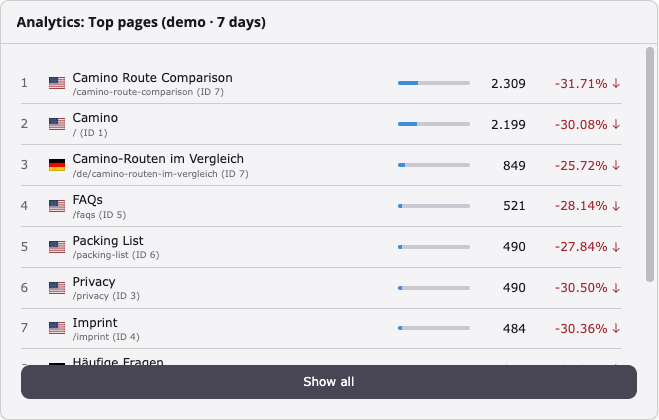
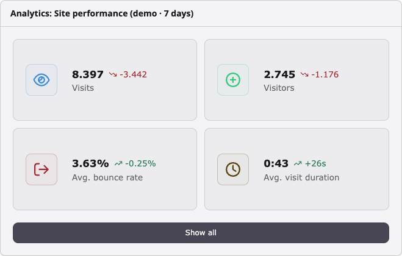
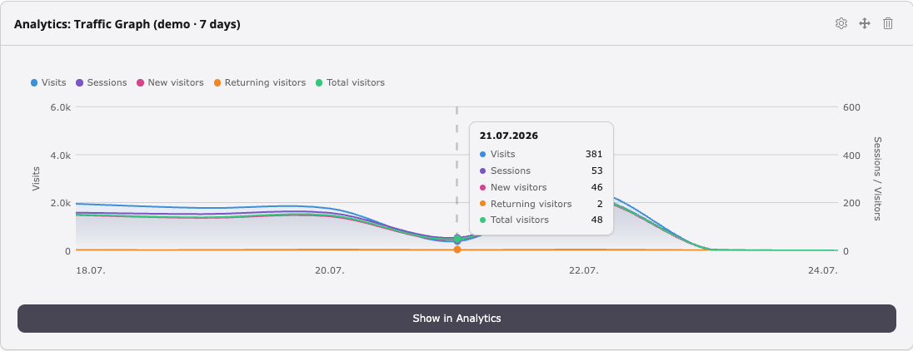
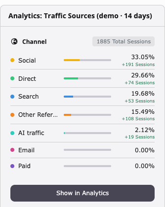
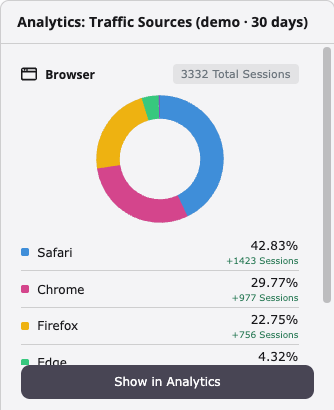
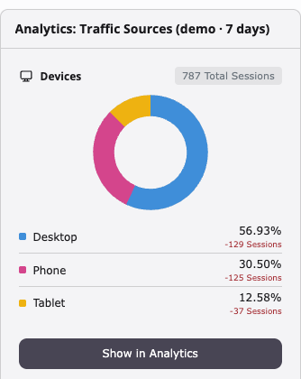
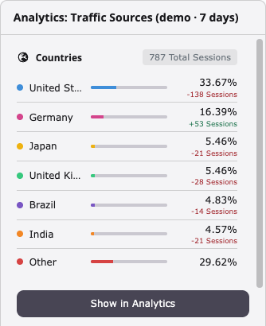
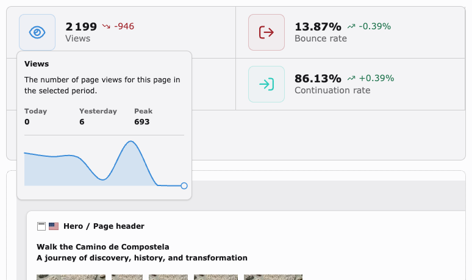

# TYPO3 Analytics Extension

A TYPO3 backend extension that integrates **TYPO3 Analytics** into the TYPO3 site management panel. It lets editors register TYPO3 sites with the TYPO3 Analytics API, monitor registration status, and open the analytics dashboard — all without leaving the TYPO3 backend.

## Contents

- [Requirements](#requirements)
- [What the extension does](#what-the-extension-does)
- [Installation](#installation)
- [Configuration reference](#configuration-reference)
  - [Development settings](#development-settings)
  - [Dashboard settings](#dashboard-settings)
- [Modules and widgets](#modules-and-widgets)
  - [Backend module — Sites → Analytics](#backend-module--sites--analytics)
  - [Dashboard widgets](#dashboard-widgets)
  - [Page Performance Bar](#page-performance-bar)
  - [Dashboard preset](#dashboard-preset)
  - [Access control](#access-control)
- [Local development with DDEV](#local-development-with-ddev)
- [Compatibility notes](#compatibility-notes)

## Requirements

| Component | Version |
|-----------|---------|
| PHP | ^8.2 |
| TYPO3 | ^13.4.18 or ^14.0 |
| libsodium | PHP extension (bundled since PHP 7.2) |

## What the extension does

The extension adds a **Sites → Analytics** module to the TYPO3 backend. For each configured TYPO3 site it provides:

- **Registration** — enter an e-mail address and register the site with the TYPO3 Analytics API.
- **Status display** — shows the current analytics status fetched via HMAC-authenticated API calls (cached for 24 h, manually refreshable).
- **Dashboard** — opens the TYPO3 Analytics dashboard as an embedded iframe inside the TYPO3 backend.
- **Tracking code injection** — once a site is registered, the TYPO3 Analytics tracking script is automatically injected into every frontend HTML response for that site.

### Encryption

Credentials are encrypted using XChaCha20-Poly1305 via libsodium. On TYPO3 v14+ the built-in `TYPO3\CMS\Core\Crypto\Cipher\CipherService` is used automatically; on v13 an equivalent custom implementation is used, ensuring values remain decryptable after an upgrade.


### Module icon

Two icon variants are shipped and selected automatically at runtime based on the installed TYPO3 version:

| File | Used on | Design |
|------|---------|--------|
| `Resources/Public/Icons/Extension.svg` | TYPO3 v14+ | Adaptive — uses `var(--icon-color-accent)` and `currentColor` to follow the backend theme |
| `Resources/Public/Icons/Extension-v13.svg` | TYPO3 v13 | Material Design — solid orange background with white bar-chart bars |

## Installation

### Composer (recommended)

```bash
composer require t3g/analytics
```

Activate the extension in the TYPO3 Extension Manager or via:

```bash
vendor/bin/typo3 extension:setup analytics
```

### TER / Classic mode

In a non-Composer TYPO3 installation, search for **analytics** in **Admin Tools → Extensions** and install it from there. Make sure the **Dashboard** system extension is active before installing.

### Deployment note

The extension writes data for each site: credentials, tracking code and API key. These values are sensitive. Do not commit them to the repository.

By default, the extension writes the data into `config/sites/<identifier>/settings.yaml`. In a deployment setup, keep this file in a shared folder outside the release directory.

If other extensions also use `settings.yaml`, the file must stay in the repository. In this case, set `siteDataPath`. We recommend `config/analytics`. The extension then writes the data into `config/analytics/<identifier>.yaml`. Keep only this directory in a shared folder.

- Share the directory, not the single files. The extension replaces a file on each write. This removes a symbolic link to a single file.
- Set `siteDataPath` in the extension configuration. Then the backend, the frontend and the CLI use the same location. If you use the environment variable instead, set it for the web server and for the CLI.
- In classic mode (no Composer), the project root is the web root. Use an absolute path outside the web root, or deny web access to the directory. The same applies to `typo3conf/sites/`.

An existing installation continues to work after you set `siteDataPath`. If a value is not in the separate file, the extension reads it from `settings.yaml`. The first write copies all values into the separate file. After this, you can remove the values of the extension from `settings.yaml`.

If you remove `siteDataPath` again, the extension reads `settings.yaml` again. Old values in `settings.yaml` then apply. Copy the values from the separate file back into `settings.yaml` first.

## Configuration reference

### Development settings

| Key | Type | Default | Description |
|-----|------|---------|-------------|
| `demoData` | bool | `0` | When enabled, replaces all analytics API calls with static demo data. Only takes effect in the TYPO3 `Development` application context. |

### Dashboard settings

| Key | Type | Default | Description |
|-----|------|---------|-------------|
| `dashboardPeriods` | string | `7,14,30` | Comma-separated list of period options (in days) shown in all dashboard widget dropdowns and the page performance bar. Must be positive integers. |
| `dashboardDefaultPeriod` | int | `7` | Pre-selected period (in days) for all dashboard widgets. Must be one of the values in `dashboardPeriods`. |

**Example — custom period options:**

```php
$GLOBALS['TYPO3_CONF_VARS']['EXTENSIONS']['analytics']['dashboardPeriods'] = '7,30,90';
$GLOBALS['TYPO3_CONF_VARS']['EXTENSIONS']['analytics']['dashboardDefaultPeriod'] = 30;
```

### Cache settings

| Key | Type | Default | Description |
|-----|------|---------|-------------|
| `pageAnalyticsCacheTtl` | int | `3600` | Lifetime in seconds for all analytics data caches. Increase this value to reduce API calls on high-traffic backend installations. |

**Example — longer cache lifetime:**

```php
$GLOBALS['TYPO3_CONF_VARS']['EXTENSIONS']['analytics']['pageAnalyticsCacheTtl'] = 7200;
```

### Site data settings

| Key | Type | Default | Description |
|-----|------|---------|-------------|
| `siteDataPath` | string | _(empty)_ | Directory for the site data files (`<siteDataPath>/<identifier>.yaml`). A relative path starts at the project root. Recommended: `config/analytics`. Leave empty to keep the data in `settings.yaml`. The environment variable `TYPO3_ANALYTICS_SITE_DATA_PATH` has priority. |

## Modules and widgets

### Backend module — Sites → Analytics

Registered as `site_analytics` (route prefix `site_analytics.*`). Visible in the **Sites** section of the backend module menu.

The module overview page shows:

- **Plans** — a responsive card grid of all available Analytics plans, loaded via AJAX. Each card shows the plan name, price (monthly / yearly toggle), credit volume, API access, and custom-dashboard availability. A **Custom** plan card is always appended at the end with a "Contact us" button for enterprise inquiries.
- **Active / inactive sites** — all configured TYPO3 sites grouped by registration status.

Per-site views offer:
- **Registration** — enter an e-mail address to register a site with the TYPO3 Analytics API.
- **Status** — shows registration status, website ID and API key, with a manual refresh button.
- **Dashboard** — embeds the TYPO3 Analytics web dashboard as an iframe.

The registration form, plan management button, and status refresh button are only visible to backend administrators and users who hold the **Analytics Manager** custom option (see [Access control](#access-control) below).

### Dashboard widgets

The extension registers four dashboard widget types, each available in a TYPO3 v13 variant (inline dropdowns, AJAX-driven) and a TYPO3 v14+ variant (native widget settings panel).

All v14+ widgets share two common settings in addition to their widget-specific ones:

| Setting | Type | Default | Description |
|---------|------|---------|-------------|
| **Title** | string | _(widget default)_ | Overrides the widget title shown in the dashboard header. Leave empty to use the default. |
| **Show site & period in title** | bool | `true` | Appends the selected site name and period in parentheses to the widget title, e.g. `Traffic Sources (My Site · 7 days)`. |

#### Top Pages widget



Displays a ranked list of the most-visited pages for a configured site. Each row shows the page title, URL, and view count. Results are sorted by page views descending; a configurable limit controls how many rows are shown. A "Show all" link leads to the pages view of the analytics dashboard.

| Variant | Class | Widget ID | TYPO3 version |
|---------|-------|-----------|---------------|
| v13 | `TopPagesWidget` | `dashboard.widget.analyticsTopPages` | ^13.4 |
| v14+ | `TopPagesWidgetV14` | `dashboard.widget.analyticsTopPagesV14` | ^14.0 |

Widget settings (v14+): **Site**, **Period** (days), **Limit** (number of pages shown), plus the common settings above.

AJAX endpoint (v13): `TopPagesAjaxController` — registered as backend route `analytics_top_pages_content`.

#### Site Performance widget



Displays four colored metric tiles for a configured site — **Visits**, **Visitors**, **Bounce rate**, and **Avg. visit duration** — each showing the current value and a trend arrow compared to the previous period of equal length.

| Variant | Class | Widget ID | TYPO3 version |
|---------|-------|-----------|---------------|
| v13 | `SitePerformanceWidget` | `dashboard.widget.analyticsSitePerformance` | ^13.4 |
| v14+ | `SitePerformanceWidgetV14` | `dashboard.widget.analyticsSitePerformanceV14` | ^14.0 |

Widget settings (v14+): **Site**, **Period** (days), plus the common settings above.

AJAX endpoint (v13): `SitePerformanceAjaxController` — registered as backend route `analytics_site_performance_content`.

#### Traffic Graph widget



Displays a full-width line chart of daily visit counts for a configured site over the selected period. The chart makes traffic trends immediately visible — spikes, dips, and patterns across the chosen date range. A "Show all" link opens the main analytics dashboard.

| Variant | Class | Widget ID | TYPO3 version |
|---------|-------|-----------|---------------|
| v13 | `TrafficGraphWidget` | `dashboard.widget.analyticsTrafficGraph` | ^13.4 |
| v14+ | `TrafficGraphWidgetV14` | `dashboard.widget.analyticsTrafficGraphV14` | ^14.0 |

Widget settings (v14+): **Site**, **Period** (days), plus the common settings above.

AJAX endpoint (v13): `TrafficGraphAjaxController` — registered as backend route `analytics_traffic_graph_content`.

#### Traffic Sources widget

Displays a breakdown of incoming traffic by **channel**, **browser**, **device type**, or **country**. Each entry shows a label, share as a percentage, and a horizontal progress bar. Channel and channel entries also display a trend indicator compared to the previous period. Entries outside the top results are aggregated into an "Others" row.

The two TYPO3 version variants differ significantly in how sections are displayed:

**v13** — `TrafficSourcesWidget` / `dashboard.widget.analyticsTrafficSources` / ^13.4

All four sections (Channel, Devices, Browser, Countries) are rendered inside a single widget, stacked vertically. Site and period are selected via inline dropdowns; the chart is always a progress-bar list. No chart-type configuration is available.

AJAX endpoint: `TrafficSourcesAjaxController` — registered as backend route `analytics_traffic_sources_content`.

**v14+** — `TrafficSourcesWidgetV14` / ^14.0

A DI compiler pass registers **four separate widget types**, one per section, each with a fixed section and a pre-configured default chart type. The section cannot be changed by the user at runtime.

| Widget ID | Section | Default chart type |
|-----------|---------|-------------------|
| `dashboard.widget.analyticsTrafficSourcesChannel` | Channel | list |
| `dashboard.widget.analyticsTrafficSourcesDevices` | Devices | donut |
| `dashboard.widget.analyticsTrafficSourcesBrowser` | Browser | donut |
| `dashboard.widget.analyticsTrafficSourcesCountries` | Countries | list |

<table>
  <tr>
    <td align="center"><br><b>Channel</b></td>
    <td align="center"><br><b>Browser</b></td>
  </tr>
  <tr>
    <td align="center"><br><b>Devices</b></td>
    <td align="center"><br><b>Countries</b></td>
  </tr>
</table>

Widget settings (v14+):

| Setting | Type | Default | Description |
|---------|------|---------|-------------|
| **Site** | string | first registered site | Site to display data for. |
| **Period** | int | `dashboardDefaultPeriod` | Time window in days. |
| **Chart type** | enum | _(per widget)_ | Display as `list` (progress bars) or `donut` (SVG donut chart, top 5 + aggregated "Other"). |

Plus the common settings above.

### Page Performance Bar

An event listener (`PagePerformanceBarListener`) on `ModifyPageLayoutContentEvent` that injects an analytics bar above the page content in the **Page** module.

The bar loads **asynchronously**: on page render, only a lightweight skeleton with a loading spinner is injected into the page header. The JavaScript in `page-performance.js` then fetches the actual analytics data via AJAX (`PagePerformanceAjaxController`, route `analytics_page_performance_content`) and replaces the skeleton with the fully rendered bar.

The bar shows per-page metrics for the currently viewed page:

- Page views with sparkline and trend
- Bounce rate with sparkline and trend
- Average time on page with sparkline and trend
- Continuation rate (100 − bounce rate) with sparkline and trend

A period selector (values from `dashboardPeriods`) and a link to the full site analytics dashboard are included. The bar is hidden in language-comparison mode (viewMode = 2).



### Dashboard preset

The extension ships a ready-made **Analytics Overview** dashboard preset (`analyticsOverview`) that can be selected when creating a new TYPO3 dashboard. It pre-populates the dashboard with all four widget types:

- Traffic Graph
- Site Performance
- Top Pages
- Traffic Sources (channel, devices, browser, countries — one widget per section)

The preset is registered in `Configuration/Backend/DashboardPresets.php` and shown in the dashboard creation wizard (`showInWizard: true`).

### Access control

The Sites → Analytics module is accessible to all backend users. However, the following actions are restricted to **administrators** and users who hold the `tx_analytics:manager` custom option:

- Registering a new site with the Analytics API
- Subscribing to or managing a plan
- Manually refreshing the registration status

The custom option is configured via **Backend Groups → Custom Options → Analytics → Analytics Manager** (TCA value: `tx_analytics:manager`).

## Local development with DDEV

The repository ships a fully automated DDEV environment that spins up a dummy TYPO3 installation with five sub-domain sites.

### Prerequisites

- [DDEV](https://ddev.readthedocs.io/) installed
- Docker running

### Start the environment

```bash
ddev start
```

On first start DDEV automatically runs the setup script. You will be prompted to choose the TYPO3 major version:

```
TYPO3 version to install (13/14) [13]:
```

The script will:

1. Create a fresh TYPO3 project in `.Build/dummy-typo3/` using `typo3/cms-base-distribution`
2. Drop and recreate the database for a clean slate
3. Require and symlink this extension from the repository root
4. Run `vendor/bin/typo3 setup` non-interactively
5. Create five root pages (Site 1–5)
6. Write site configurations for five subdomains
7. Remove the `FIRST_INSTALL` flag so the backend is immediately accessible

### Available URLs after setup

| URL | Description |
|-----|-------------|
| `https://analytics.ddev.site/typo3` | TYPO3 backend |
| `https://site1.analytics.ddev.site/` | Frontend site 1 |
| `https://site2.analytics.ddev.site/` | Frontend site 2 |
| `https://site3.analytics.ddev.site/` | Frontend site 3 |
| `https://site4.analytics.ddev.site/` | Frontend site 4 |
| `https://site5.analytics.ddev.site/` | Frontend site 5 |
| `https://analytics.ddev.site:1337` | Documentation preview |

**Backend credentials:** `admin` / `Admin1234!`

### Re-run setup manually

```bash
ddev exec composer dummy-typo3
```

### Reset everything

```bash
# Remove the dummy installation (keeps DDEV containers)
rm -rf .Build/dummy-typo3

# Then restart — setup runs automatically
ddev restart
```

### Run an additional environment in parallel

You can run an additional environment next to the existing one, for example to test with another TYPO3 version.
Use another checkout of the repository for this, for example a clone or a `git worktree`.

Two DDEV projects with the same name cannot run at the same time.
The project name in `.ddev/config.yaml` is `analytics`.
Do not change `.ddev/config.yaml`.
Set a different name in a local override file instead.

1. In the other checkout, create the file `.ddev/config.local.yaml`:

   ```yaml
   name: analytics-v14
   override_config: true
   additional_fqdns:
       - site1.analytics-v14.ddev.site
       - site2.analytics-v14.ddev.site
       - site3.analytics-v14.ddev.site
       - site4.analytics-v14.ddev.site
       - site5.analytics-v14.ddev.site
   ```

   `override_config: true` replaces the list `additional_fqdns`.
   Without it, DDEV adds the new host names to the host names from `.ddev/config.yaml`.

2. Run `ddev start` in the other checkout.
3. Select the TYPO3 version when the setup script asks for it.

The setup script reads the host name from DDEV.
Thus, the URLs of the additional environment use the new name, for example `https://analytics-v14.ddev.site/typo3`.
Git ignores the file `.ddev/config.local.yaml`.

### Documentation preview

The [ddev-typo3-docs](https://github.com/TYPO3-Documentation/ddev-typo3-docs) add-on renders the `.rst` files in `Documentation/` with the same renderer used by docs.typo3.org. It starts automatically with `ddev start`/`ddev restart` and watches for changes.

Open **https://analytics.ddev.site:1337** and edit files under `Documentation/` — the preview re-renders automatically on save.

### Code quality

```bash
# PHP CS Fixer (dry-run)
composer t3g:cgl

# PHP CS Fixer (fix)
composer t3g:cgl:fix

# PHPStan
composer t3g:phpstan

# Rector (dry-run)
composer t3g:rector:dry-run

# Rector (apply)
composer t3g:rector:fix
```

### Tests

```bash
# All tests
composer t3g:test

# Unit tests only
composer t3g:test:unit

# Functional tests (SQLite, no external DB required)
composer t3g:test:functional
```

Unit tests use the TYPO3 testing framework with an in-process bootstrap. Functional tests use SQLite via `pdo_sqlite` — no external database server is required.

## Compatibility notes

### TYPO3 v13

- `ext_emconf.php` is required and evaluated by TYPO3.
- The custom sodium-based cipher is used for credential encryption.
- Module access is controlled via `'access' => 'user'`.
- The Material Design icon (`Extension-v13.svg`) is used automatically.

### TYPO3 v14

- `ext_emconf.php` is deprecated ([Feature #108345](https://docs.typo3.org/c/typo3/cms-core/main/en-us/Changelog/14.2/Feature-108345-No-ext-em-conf-in-classic-mode.html)). Extension metadata is read from `composer.json` (`extra.typo3/cms`).
- The built-in `TYPO3\CMS\Core\Crypto\Cipher\CipherService` is used automatically.
- Module access uses the gate-registry pattern; `'user,group'` is no longer valid — `'user'` is used instead.
- The adaptive theme icon (`Extension.svg`) is used automatically.
